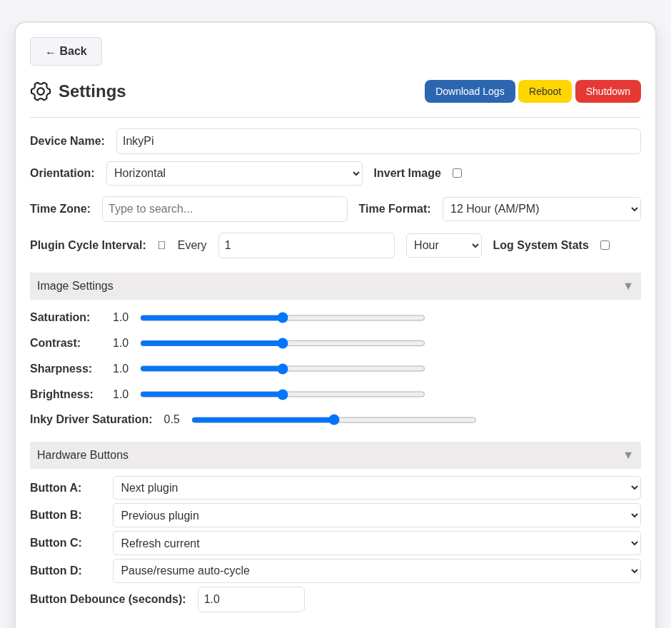

# inkypi-frame-hardwarebuttons

Patches, docs, and a setup script for running [InkyPi](https://github.com/fatihak/InkyPi)
with hardware button support on Pimoroni Inky Impression e-ink frames. This is
not a fork of InkyPi itself — it only contains what's added on top of it.

Validated on an Inky Impression 7.3" (2025 board revision, the one with the
seal), on both an original Raspberry Pi Zero W (ARMv6) and a Raspberry Pi
Zero 2 W (ARMv8/`aarch64`).

## Contents

- **`patches/button-support.patch`** — adds support for all 4 Inky Impression
  hardware buttons (A/B/C/D): cycle playlist next/previous, force-refresh,
  pause/resume auto-cycling, or jump to a specific plugin/playlist. See
  [`docs/BUTTONS.md`](docs/BUTTONS.md) for what each button does, how to
  configure it from the dashboard, and the full list of files it touches.
- **`patches/armv6-wkhtmltoimage-fallback.patch`** — on an original Raspberry
  Pi Zero W (ARMv6), Chromium crashes with `SIGILL` since Debian/Raspbian's
  `chromium-headless-shell` package requires ARMv7+, which breaks any
  HTML/CSS-rendered plugin (e.g. weather). This patch falls back to
  `wkhtmltoimage` automatically when Chromium is missing or fails. See
  [`docs/ARMV6-RENDERING.md`](docs/ARMV6-RENDERING.md) for the full story.
  Not needed on 64-bit Pi hardware (Zero 2 W, 3/4/5).
- **`install/apply-button-support.sh`** — applies the button patch to an
  existing InkyPi checkout and automates every gotcha that comes with it
  (SPI/I2C + single-CS overlay setup, a `python3-dev`/pip-retry workaround for
  a race condition in InkyPi's own installer, and a final restart +
  verification). Idempotent, safe to re-run.

## Using this

1. Install InkyPi normally, following [its own instructions](https://github.com/fatihak/InkyPi#installation).
2. Clone this repo somewhere on the Pi.
3. Run `install/apply-button-support.sh /path/to/your/InkyPi/checkout`.
4. If it tells you a reboot is needed, reboot and run it again.

If you're on a Pi Zero W (ARMv6) and want the weather plugin to work, also
apply `patches/armv6-wkhtmltoimage-fallback.patch` to your InkyPi checkout
(`git apply`) and `sudo apt-get install -y wkhtmltopdf`.
